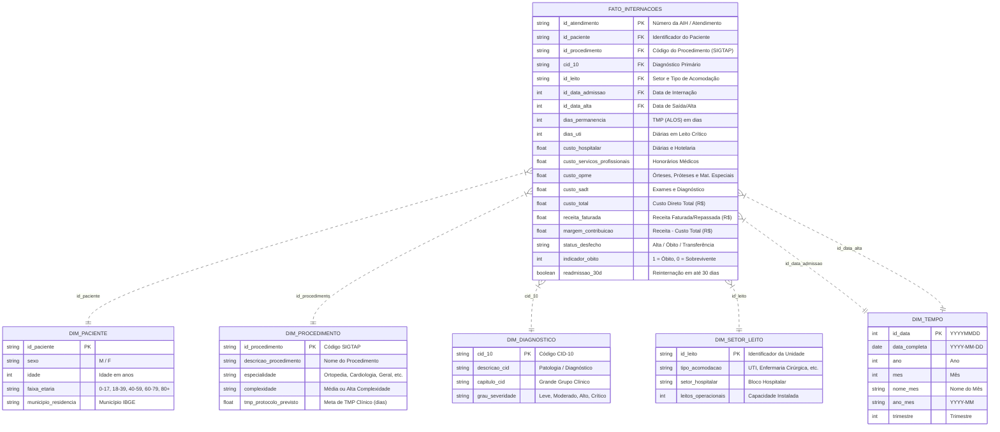

# 🏥 Healthcare Analytics: Gestão de Custos, Ociosidade de Leitos e Eficiência Hospitalar


Projeto end-to-end de **Inteligência de Dados Hospitalares (Healthcare Analytics)** voltado para a **Diretoria Médico-Financeira**, Gestores de Linhas de Cuidado e Núcleos Internos de Regulação (NIR). O objetivo é equilibrar a **eficiência assistencial (qualidade do cuidado)** com a **sustentabilidade econômico-financeira (margem, controle de OPME e giro de leitos)**.

---

## 🎯 1. O Problema de Negócio

No setor de saúde, a gestão hospitalar enfrenta a **Tríplice Meta (Triple Aim)**: melhorar o desfecho clínico do paciente, garantir segurança e controlar os custos crescentes de internação.

A governança executiva precisa responder a quatro perguntas estratégicas:

1. **Rentabilidade e Margem de Contribuição:** Quais especialidades e procedimentos geram maior retorno financeiro versus quais operam em déficit crônico?
2. **Tempo Médio de Permanência (TMP / ALOS):** Os pacientes estão recebendo alta dentro do protocolo clínico previsto ou gerando custo excessivo de diárias excedentes?
3. **Gestão de Leitos e Capacidade:** Como se comporta a taxa de ocupação entre leitos críticos (UTI) e enfermarias? Há risco de saturação ou desperdício por ociosidade?
4. **Qualidade Clínica e Readmissão em 30 Dias:** Quais patologias apresentam altos índices de reinternação precoce, sinalizando desfechos adversos ou descontinuidade terapêutica?

---

## 🏗️ 2. Arquitetura da Solução

```
[ DATASUS / SIH-SUS ] ---> [ PySUS Extractor ] ---> [ data/raw/ (Parquet) ]
                                                            │
                                                            ▼
                                                   [ ETL Pandas / DuckDB ]
                                                            │
   ┌───────────────────────┬────────────────────────┬───────┴────────────────────────┐
   ▼                       ▼                        ▼                                ▼
[ dim_tempo ]      [ dim_paciente ]     [ dim_procedimento ]               [ dim_diagnostico ]
   │                       │                        │                                │
   └───────────────────────┼────────────────────────┼────────────────────────────────┘
                           ▼                        ▼
                [ fato_internacoes ] ◄──── [ dim_setor_leito ]
                           │
       ┌───────────────────┴───────────────────┐
       ▼                                       ▼
[ DuckDB / Supabase Cloud ]            [ Power BI / Looker ]
 • 02_analytical_queries.sql            • Painel Executivo Médico-Financeiro
 • 03_views_bi.sql                      • Gestão de Ocupação & Giro de Leitos
 • sql/supabase_setup.sql               • Detalhamento de Risco e Readmissão
```

---

## ⭐ 3. Modelagem Dimensional (Star Schema)

A modelagem analítica foi construída em esquema estrela (*Star Schema*), otimizada para alto desempenho em bancos colunares (DuckDB, BigQuery, PostgreSQL):



---

## 📈 4. Principais Insights & Storytelling dos Dados

A aplicação das consultas analíticas em SQL (`sql/02_analytical_queries.sql`) sobre a base hospitalar revelou diagnósticos executivos cruciais:

### 🔍 Descoberta 1: O Paradoxo da Ortopedia (Volume Alto vs. Margem Crítica)
* **Achado:** A especialidade de **Ortopedia & Traumatologia** foi a segunda maior em faturamento (R$ 72,1 milhões; 27,7% da receita hospitalar total), porém obteve a **menor margem de contribuição (apenas 2,63%)**.
* **Causa Raiz:** O custo de **OPME (Órteses, Próteses e Materiais Especiais)** representou expressivos **46,41% de todos os custos da especialidade** (R$ 32,6 milhões em próteses de quadril e joelho), com disparidade de preços de até 120% entre fornecedores para o mesmo procedimento.
* **Ação Recomendada:** Instituir imediatamente comitê de padronização de OPME, consolidação de tabela unificada de fornecedores e auditoria concorrente pré-cirúrgica.

### ⏱️ Descoberta 2: Diárias Excedentes e Ineficiência de Permanência (TMP)
* **Achado:** Pacientes cirúrgicos ortopédicos apresentaram TMP real de **5,2 dias vs. 4,5 dias previstos em diretriz clínica** (+0,7 dias de desvio médio).
* **Impacto Financeiro:** O custo de diárias excedentes além do protocolo gerou um desperdício acumulado estimado em **R$ 12,2 milhões** no ano.
* **Ação Recomendada:** Implementação de protocolo de alta segura precoce (Fast-Track Surgical Recovery) e fisioterapia motora precoce nas primeiras 12h pós-operatórias para reduzir em 0,7 dias a permanência, liberando aproximadamente 24 leitos/mês de capacidade instalada.

### 💡 Descoberta 3: Cirurgia Geral como Alavanca de Margem
* **Achado:** A **Cirurgia Geral e Digestiva** registrou a maior margem de contribuição do hospital (**25,90%**), com procedimentos videolaparoscópicos rápidos (TMP de 1,5 dias), giro acelerado de leito e baixíssimo consumo de materiais especiais (OPME representou apenas 5,03% dos custos).
* **Ação Recomendada:** Priorizar o agendamento de cirurgias do aparelho digestivo em bloco cirúrgico e criar linha de cuidado dedicada de *Day Hospital* (cirurgias ambulatoriais de 24h).

---

## 📊 5. Estrutura das Telas do Dashboard (Power BI / Looker)

O projeto contém o guia visual e o catálogo de fórmulas DAX em [`powerbi/`](file:///Users/nycolas/gestao-hospitalar-analytics/powerbi/):

1. **Tela 1: Visão Executiva Médico-Financeira**
   * KPIs: Total de Internações, TMP Médio Geral, Margem Total (R$ e %), Taxa de Readmissão 30d.
   * Gráfico de Dispersão (Matriz de Eficiência): *Tempo de Permanência (X)* vs. *Margem % (Y)* vs. *Custo Total (Tamanho da Bolha)*.
   * Curva ABC (Pareto) de Procedimentos e Especialidades.

2. **Tela 2: Gestão Operacional de Leitos & Eficiência**
   * Mapa de Calor (Heatmap) da Taxa de Ocupação mensal por setor (alerta de saturação em UTI > 85% e ociosidade em enfermarias < 65%).
   * Gráfico de colunas com desvio de permanência (TMP Real vs. Meta de Protocolo).
   * Indicador de Giro de Leito (Pacientes atendidos por leito-dia).

3. **Tela 3: Detalhamento de Risco, Readmissão & Qualidade Clínica**
   * Gráfico com Top 10 Patologias (CID-10) com maior incidência de reinternações em 30 dias.
   * Tabela analítica com cruzamento de severidade clínica, desfecho (alta vs. óbito) e custos associados.

---

## 📂 6. Estrutura do Repositório

```bash
gestao-hospitalar-analytics/
├── data/
│   ├── raw/                  # Arquivos brutos baixados (Parquet SIH/SUS DATASUS)
│   └── processed/            # Tabelas dimensionais, Fato e banco DuckDB
├── sql/
│   ├── 01_ddl_star_schema.sql         # Script DDL ANSI SQL com tabelas e índices
│   ├── 02_analytical_queries.sql      # Queries analíticas (Margem, TMP, Leitos, Readmissão, ABC)
│   └── 03_views_bi.sql                # Views analíticas para integração com BI
├── src/
│   ├── extract_sih_sus.py             # Extração automatizada de AIH do DATASUS via PySUS
│   ├── transform_star_schema.py       # Pipeline ETL de saneamento e modelagem dimensional
│   └── generate_benchmark_dataset.py  # Gerador de benchmark hospitalar clínico-financeiro
├── powerbi/
│   ├── dax_measures.dax               # Catálogo completo de métricas DAX prontas para Power BI
│   └── dashboard_wireframe.md         # Wireframe detalhado das telas, layout e cores
├── docs/
│   ├── business_problem.md            # Problema de negócio, dores e Tríplice Meta da Saúde
│   └── data_dictionary.md             # Dicionário de dados dos campos do DATASUS e Star Schema
├── requirements.txt                   # Dependências do projeto (pysus, duckdb, pandas, pyarrow)
└── README.md                          # Apresentação executiva e técnica do projeto
```

---

## 🚀 7. Como Executar o Projeto

### API REST na Vercel

O diretório `api/` contém funções serverless somente de leitura para os dados analíticos. Importe o repositório na Vercel e configure `SUPABASE_URL` e `SUPABASE_PUBLISHABLE_KEY` nas variáveis de ambiente do projeto. A API também aceita `SUPABASE_KEY` como compatibilidade com a chave pública antiga. Não configure a chave `secret`/`service_role` para estas rotas. A página `/login.html` permite criar conta e entrar com e-mail e senha do Supabase Auth. Os endpoints de dados exigem `Authorization: Bearer <access_token>`; `/api/health` permanece público.

| Rota | Uso | Filtros opcionais |
| --- | --- | --- |
| `GET /api/health` | Verifica se a função está ativa | — |
| `GET /api/executive` | KPIs mensais por especialidade | `ano_mes`, `especialidade`, `limit` |
| `GET /api/beds` | Ocupação e giro por setor | `ano_mes`, `id_leito`, `limit` |
| `GET /api/risk` | Detalhes clínicos sem identificadores de paciente/atendimento | `cid_10`, `especialidade`, `grau_severidade`, `limit` |
| `GET /api/filters?dimension=...` | Dimensões para filtros do dashboard | `dimension`: `procedures`, `diagnoses`, `beds` ou `months`; `limit` |

Exemplos:

```bash
curl 'https://SEU-PROJETO.vercel.app/api/health'
curl 'https://SEU-PROJETO.vercel.app/api/executive?ano_mes=2023-01&limit=50' \\
  -H 'Authorization: Bearer SEU_ACCESS_TOKEN'
curl 'https://SEU-PROJETO.vercel.app/api/beds?ano_mes=2023-01' -H 'Authorization: Bearer SEU_ACCESS_TOKEN'
curl 'https://SEU-PROJETO.vercel.app/api/risk?grau_severidade=Crítico&limit=25' -H 'Authorization: Bearer SEU_ACCESS_TOKEN'
curl 'https://SEU-PROJETO.vercel.app/api/filters?dimension=procedures' -H 'Authorization: Bearer SEU_ACCESS_TOKEN'
```

As rotas de dados retornam JSON no formato `{ "data": [...], "count": 1, "limit": 100 }`. O limite por chamada é 1.000 linhas. Execute `sql/supabase_setup.sql` no Supabase para criar tabelas e views e restringir leitura à role `authenticated`. Em **Authentication → Providers → Email**, habilite e configure o provedor de e-mail; ajuste as URLs permitidas para incluir o domínio publicado e `http://localhost:3000/**` no desenvolvimento. A chave publishable fica acessível no navegador por desenho; nunca exponha a chave `service_role`/secret.

### Pré-requisitos
* Python 3.10+ instalado
* Pip atualizado

### Passo a Passo

1. **Clonar ou acessar o repositório:**
```bash
cd gestao-hospitalar-analytics
```

2. **Instalar dependências:**
```bash
pip install -r requirements.txt
```

3. **Opção A: Extrair dados reais do DATASUS (SIH/SUS):**
```bash
# Baixa as internações do Acre (AC) de janeiro de 2023
python3 src/extract_sih_sus.py --state AC --year 2023 --month 1

# Processa e gera o Star Schema
python3 src/transform_star_schema.py
```

4. **Opção B: Gerar dataset de benchmark clínico-financeiro (15.000 internações completas):**
```bash
python3 src/generate_benchmark_dataset.py
```

5. **Executar consultas analíticas no DuckDB:**
```bash
python3 -c "import duckdb
con = duckdb.connect('data/processed/hospital_analytics.duckdb')
print(con.execute('SELECT especialidade, COUNT(*), ROUND(AVG(dias_permanencia), 1) as tmp, ROUND(SUM(margem_contribuicao), 2) as margem FROM fato_internacoes f JOIN dim_procedimento p ON f.id_procedimento = p.id_procedimento GROUP BY especialidade ORDER BY margem DESC').df())
"
```

6. **Carregar o Star Schema no Supabase (Nuvem):**
* Execute o script [`sql/supabase_setup.sql`](file:///Users/nycolas/gestao-hospitalar-analytics/sql/supabase_setup.sql) no **SQL Editor** do Supabase.
* Copie o arquivo de variáveis de ambiente: `cp .env.example .env` e adicione suas credenciais do projeto Supabase.
* Execute a carga automatizada:
```bash
# Carga via API REST PostgREST (não requer driver PostgreSQL)
python3 src/load_to_supabase.py --method api

# Ou carga direta PostgreSQL (via SQLAlchemy / psycopg2)
python3 src/load_to_supabase.py --method direct
```
* Consulte o guia completo em [`docs/supabase_integration.md`](file:///Users/nycolas/gestao-hospitalar-analytics/docs/supabase_integration.md).

7. **Importar no Power BI:**
* Abra o Power BI Desktop.
* Conecte-se aos arquivos locais em [`data/processed/`](file:///Users/nycolas/gestao-hospitalar-analytics/data/processed/) ou diretamente ao **Supabase (PostgreSQL)** nas views `vw_painel_executivo_mensal`, `vw_eficiencia_leitos_setor` e `vw_detalhe_clinico_risco`.
* Cole as medidas DAX do arquivo [`powerbi/dax_measures.dax`](file:///Users/nycolas/gestao-hospitalar-analytics/powerbi/dax_measures.dax).

---

## 👨‍💻 Autor
Desenvolvido por **Nycolas Gabriel**  
*Estudante de Análise e Desenvolvimento de Sistemas / Engenharia e Análise de Dados*  
Foco em SQL Avançado, Modelagem Dimensional, Analytics Engineering e Saúde Baseada em Valor (*Value-Based Healthcare*).
