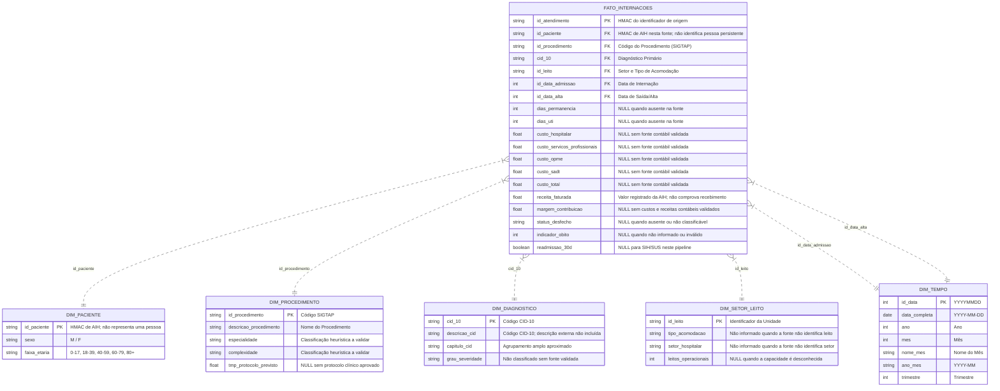

# 🏥 Healthcare Analytics: Gestão de Custos, Ociosidade de Leitos e Eficiência Hospitalar


Protótipo de analytics hospitalar para explorar eficiência assistencial e métricas operacionais e financeiras. O benchmark incluído é inteiramente sintético; qualquer uso de dados reais exige governança, autorização e validação pelo controlador.

---

## 🎯 1. O Problema de Negócio

No setor de saúde, a gestão hospitalar enfrenta a **Tríplice Meta (Triple Aim)**: melhorar o desfecho clínico do paciente, garantir segurança e controlar os custos crescentes de internação.

A governança executiva precisa responder a quatro perguntas estratégicas:

1. **Rentabilidade e Margem de Contribuição:** Quais especialidades e procedimentos geram maior retorno financeiro versus quais operam em déficit crônico?
2. **Tempo Médio de Permanência (TMP / ALOS):** Os pacientes estão recebendo alta dentro do protocolo clínico previsto ou gerando custo excessivo de diárias excedentes?
3. **Gestão de Leitos e Capacidade:** Como se comporta a taxa de ocupação entre leitos críticos (UTI) e enfermarias? Há risco de saturação ou desperdício por ociosidade?
4. **Qualidade Clínica e Readmissão em 30 Dias:** Quais patologias apresentam altos índices de reinternação precoce, sinalizando desfechos adversos ou descontinuidade terapêutica?

---

## 🏗️ 2. Arquitetura da Solução

```
[ DATASUS / SIH-SUS ] ---> [ PySUS Extractor ] ---> [ data/raw/ (Parquet) ]
                                                            │
                                                            ▼
                                                   [ ETL Pandas / DuckDB ]
                                                            │
   ┌───────────────────────┬────────────────────────┬───────┴────────────────────────┐
   ▼                       ▼                        ▼                                ▼
[ dim_tempo ]      [ dim_paciente ]     [ dim_procedimento ]               [ dim_diagnostico ]
   │                       │                        │                                │
   └───────────────────────┼────────────────────────┼────────────────────────────────┘
                           ▼                        ▼
                [ fato_internacoes ] ◄──── [ dim_setor_leito ]
                           │
       ┌───────────────────┴───────────────────┐
       ▼                                       ▼
[ DuckDB / Supabase Cloud ]            [ Power BI / Looker ]
 • 02_analytical_queries.sql            • Painel Executivo Médico-Financeiro
 • sql/supabase_setup.sql               • Detalhamento de Risco e Readmissão
```

---

## ⭐ 3. Modelagem Dimensional (Star Schema)

A modelagem analítica foi construída em esquema estrela (*Star Schema*), otimizada para alto desempenho em bancos colunares (DuckDB, BigQuery, PostgreSQL):



---

## 📈 4. Escopo e limites dos dados

O dataset gerado por `src/generate_benchmark_dataset.py` é simulado e serve apenas para demonstração técnica. Valores de receita, custos, mortalidade, ocupação e readmissão não descrevem um hospital real e não devem embasar decisões clínicas ou financeiras. As consultas em `sql/02_analytical_queries.sql` são modelos para aplicar a bases autorizadas e validadas.

No fluxo SIH/SUS, a chave AIH é pseudonimizada com HMAC e não representa uma pessoa persistente. Por isso, a readmissão em 30 dias fica desconhecida (`NULL`) para dados reais. Os arquivos transformados mantêm dados clínicos por internação e continuam sendo dados sensíveis; pseudonimização não equivale a anonimização.

---

## 📊 5. Estrutura das Telas do Dashboard (Power BI / Looker)

O projeto contém um preview estático sintético, wireframes e fórmulas DAX em [`powerbi/`](powerbi/). O preview é público e não está conectado às rotas autenticadas; ele não contém dados reais.

1. **Tela 1: Visão Executiva Médico-Financeira**
   * KPIs: Total de Internações e TMP Médio. Margem e valores financeiros só aparecem com uma fonte contábil validada; readmissão exige uma fonte com identificador de pessoa apropriado.
   * Gráfico de Dispersão (Matriz de Eficiência): *Tempo de Permanência (X)* vs. *Margem % (Y)* vs. *Custo Total (Tamanho da Bolha)*.
   * Curva ABC (Pareto) de Procedimentos e Especialidades.

2. **Tela 2: Gestão Operacional de Leitos & Eficiência**
   * Mapa de Calor da ocupação somente após integrar capacidade instalada por setor; o SIH/SUS deste pipeline não fornece esse dado.
   * Gráfico de colunas com desvio de permanência (TMP Real vs. Meta de Protocolo).
   * Indicador de Giro de Leito (Pacientes atendidos por leito-dia).

3. **Tela 3: Detalhamento de Risco, Readmissão & Qualidade Clínica**
   * Gráfico com indicadores por coorte; a readmissão fica indisponível para o fluxo SIH/SUS atual.
   * Coortes agregadas para indicadores disponíveis; severidade clínica não é inferida do CID, e custos ficam vazios sem fonte contábil validada.

---

## 📂 6. Estrutura do Repositório

```bash
gestao-hospitalar-analytics/
├── data/
│   ├── raw/                  # Arquivos brutos baixados (Parquet SIH/SUS DATASUS)
│   └── processed/            # Tabelas dimensionais, Fato e banco DuckDB
├── sql/
│   ├── 01_ddl_star_schema.sql         # Nota de compatibilidade; setup protegido é centralizado
│   ├── 02_analytical_queries.sql      # Queries analíticas (Margem, TMP, Leitos, Readmissão, ABC)
│   └── 03_views_bi.sql                # Nota de compatibilidade; views ficam no setup protegido
├── src/
│   ├── extract_sih_sus.py             # Extração automatizada de AIH do DATASUS via PySUS
│   ├── transform_star_schema.py       # Pipeline ETL de saneamento e modelagem dimensional
│   └── generate_benchmark_dataset.py  # Gerador de benchmark hospitalar clínico-financeiro
├── powerbi/
│   ├── dashboard_preview.html         # Painel HTML com dados agregados das rotas protegidas
│   ├── dashboard.css                  # Layout responsivo do painel
│   ├── dashboard.js                   # Filtros e visualizações com dados da API PySUS
│   ├── dax_measures.dax               # Catálogo completo de métricas DAX prontas para Power BI
│   └── dashboard_wireframe.md         # Wireframe detalhado das telas, layout e cores
├── docs/
│   ├── business_problem.md            # Problema de negócio, dores e Tríplice Meta da Saúde
│   ├── data_dictionary.md             # Dicionário de dados do DATASUS e Star Schema
│   └── security.md                    # Controles e requisitos de implantação segura
├── requirements.txt                   # Dependências do projeto (pysus, duckdb, pandas, pyarrow)
└── README.md                          # Apresentação executiva e técnica do projeto
```

---

## 🚀 7. Como Executar o Projeto

### API REST na Vercel

O diretório `api/` contém funções serverless somente de leitura. Na Vercel, configure `SUPABASE_URL` e `SUPABASE_PUBLISHABLE_KEY` (ou uma chave `anon` legada). Nunca configure a chave `secret`/`service_role` nessas rotas. O login usa links mágicos de uso único e cookies `HttpOnly`, `Secure` em produção e `SameSite=Strict`; não exige senha nem cria contas. Desative o cadastro público no Supabase e habilite acesso somente em `app_metadata.hospital_analytics_access = true`, definido por um administrador. Não use `user_metadata` para autorização. `/api/health` permanece público.

| Rota | Uso | Filtros opcionais |
| --- | --- | --- |
| `GET /api/health` | Verifica se a função está ativa | — |
| `GET /api/executive` | KPIs mensais por especialidade | `ano_mes`, `especialidade`, `limit` |
| `GET /api/beds` | Admissões e capacidade informada por setor; ocupação retorna `null` sem censo diário | `ano_mes`, `id_leito`, `limit` |
| `GET /api/risk` | Indicadores clínicos agregados por coorte; grupos com menos de 10 internações são ocultados | `ano_mes`, `cid_10`, `especialidade`, `grau_severidade`, `limit` |
| `GET /api/filters?dimension=...` | Dimensões para filtros do dashboard | `dimension`: `procedures`, `diagnoses`, `beds` ou `months`; `limit` |

Exemplos:

```bash
curl 'https://SEU-PROJETO.vercel.app/api/health'
curl -X POST 'https://SEU-PROJETO.vercel.app/api/auth/magic-link' \
  -H 'Origin: https://SEU-PROJETO.vercel.app' -H 'Content-Type: application/json' \
  --data '{"email":"usuario@hospital.org"}'
curl -b cookies.txt 'https://SEU-PROJETO.vercel.app/api/executive?ano_mes=2023-01&limit=50'
curl -b cookies.txt 'https://SEU-PROJETO.vercel.app/api/beds?ano_mes=2023-01'
curl -b cookies.txt 'https://SEU-PROJETO.vercel.app/api/risk?grau_severidade=Não%20classificado&limit=25'
curl -b cookies.txt 'https://SEU-PROJETO.vercel.app/api/filters?dimension=procedures'
```

As rotas retornam `{ "data": [...], "count": 1, "limit": 100 }`, com limite de 1.000 linhas e `Cache-Control: no-store`. Execute `sql/supabase_setup.sql` no Supabase para habilitar RLS, retirar acesso direto às tabelas e conceder somente views aprovadas. Cadastre usuários pelo fluxo administrativo do Supabase e defina `app_metadata.hospital_analytics_access` como booleano `true`. O login envia link mágico de uso único somente para contas existentes; desative signups públicos e limite as URLs de redirecionamento ao domínio publicado e aos endereços locais usados no desenvolvimento. O login deste protótipo não inclui desafio de segundo fator; habilitar MFA no painel não basta para impor AAL2, então não o considere protegido por MFA sem um fluxo de step-up e regra AAL2 nas views/API. A chave publishable pode ser pública; a chave `service_role`/secret nunca deve ir para o navegador nem para a Vercel dessas rotas.

### Pré-requisitos
* Python 3.11–3.14 instalado (a faixa compatível com a versão atual do PySUS)
* Pip atualizado

### Passo a Passo

1. **Clonar ou acessar o repositório:**
```bash
cd gestao-hospitalar-analytics
```

2. **Instalar dependências:**
```bash
pip install -r requirements.txt
```

3. **Opção A: Extrair dados reais do DATASUS (SIH/SUS):**
```bash
# Gere uma chave secreta com `python3 -c 'import secrets; print(secrets.token_hex(32))'`
# e salve em PATIENT_DATA_HMAC_KEY no .env antes de transformar os dados.
# Baixa as internações do Acre (AC) de janeiro de 2023
python3 src/extract_sih_sus.py --state AC --year 2023 --month 1

# Processa e gera o Star Schema
python3 src/transform_star_schema.py
```
O ETL não grava o número de AIH nem idade exata/município nos arquivos processados. Como o SIH/SUS não fornece uma chave persistente de pessoa neste fluxo, `readmissao_30d` fica desconhecida (`NULL`) para os dados reais; o benchmark usa readmissões simuladas.

4. **Opção B: Gerar dataset de benchmark clínico-financeiro (15.000 internações completas):**
```bash
python3 src/generate_benchmark_dataset.py
```

5. **Executar consultas analíticas no DuckDB:**
```bash
python3 -c "import duckdb
con = duckdb.connect('data/processed/hospital_analytics.duckdb')
print(con.execute('SELECT especialidade, COUNT(*), ROUND(AVG(dias_permanencia), 1) as tmp, ROUND(SUM(margem_contribuicao), 2) as margem FROM fato_internacoes f JOIN dim_procedimento p ON f.id_procedimento = p.id_procedimento GROUP BY especialidade ORDER BY margem DESC').df())
"
```

6. **Carregar o Star Schema no Supabase (Nuvem):**
* Execute o script [sql/supabase_setup.sql](sql/supabase_setup.sql) no **SQL Editor** do Supabase. Ele não apaga as tabelas; remove idade exata e município da dimensão e recria a view clínica em forma agregada. Faça backup antes da atualização. O setup não re-HMACa identificadores antigos; após a migração, substitua as linhas antigas a partir de arquivos processados com a chave HMAC antes de habilitar usuários.
* Copie o arquivo de variáveis de ambiente: `cp .env.example .env` e adicione suas credenciais do projeto Supabase.
* Execute a carga automatizada:
```bash
# Carga via API REST PostgREST (não requer driver PostgreSQL)
python3 src/load_to_supabase.py --method api

# Ou carga direta PostgreSQL (via SQLAlchemy / psycopg2)
python3 src/load_to_supabase.py --method direct
```
Para substituir dados anteriores, faça backup e use explicitamente `--method direct --truncate --confirm-truncate` com a role local apropriada.
* Consulte o guia completo em [`docs/supabase_integration.md`](docs/supabase_integration.md).

7. **Importar no Power BI:**
* Abra o Power BI Desktop.
* Gere o dataset antes de importar os arquivos de [`data/processed/`](data/processed/). Esses arquivos são ignorados pelo Git porque o pipeline real pode gerar dados de saúde.
* Para o Supabase, use um login PostgreSQL dedicado `powerbi_reader` com acesso somente às views agregadas; nunca use o usuário mestre `postgres`. Veja as instruções em [docs/supabase_integration.md](docs/supabase_integration.md).
* Cole as medidas DAX do arquivo [`powerbi/dax_measures.dax`](powerbi/dax_measures.dax).

---

## 👨‍💻 Autor
Desenvolvido por **Nycolas Gabriel**  
*Estudante de Análise e Desenvolvimento de Sistemas / Engenharia e Análise de Dados*  
Foco em SQL Avançado, Modelagem Dimensional, Analytics Engineering e Saúde Baseada em Valor (*Value-Based Healthcare*).
